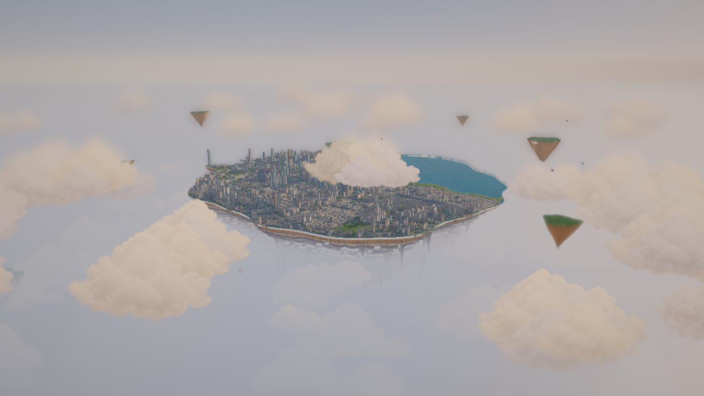
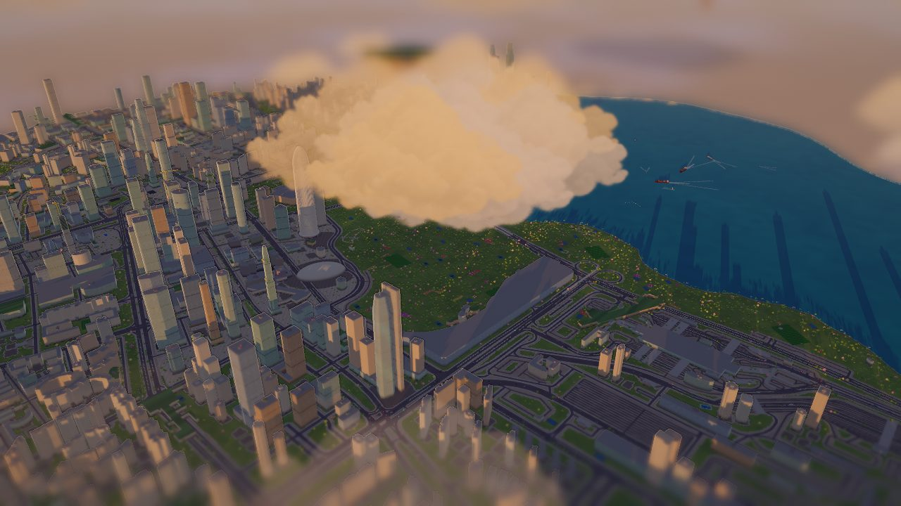
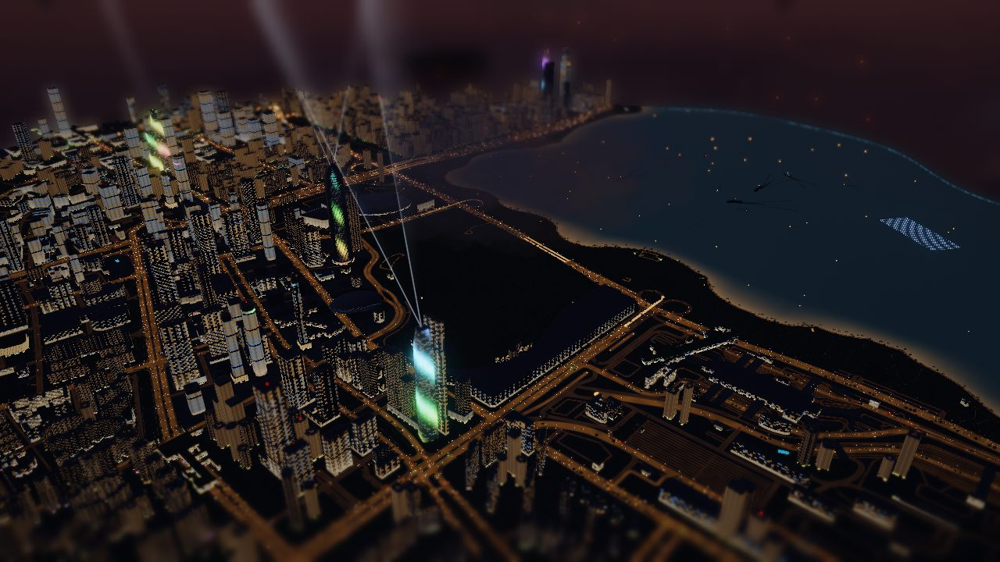
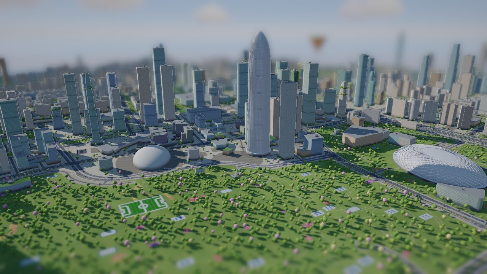
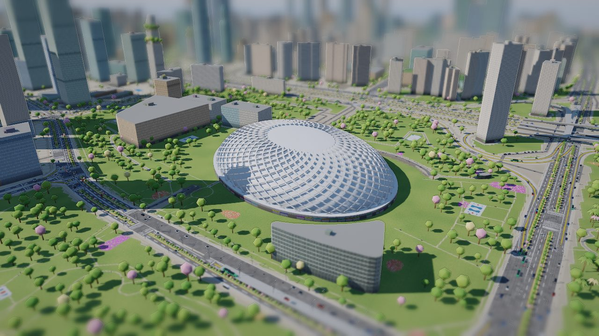
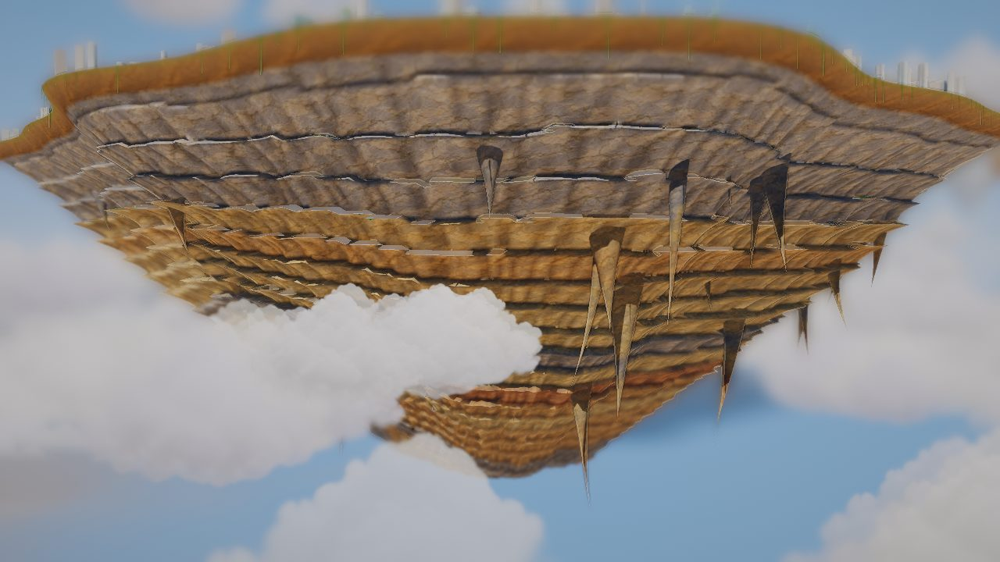

# 深圳湾 · 空中之岛

把深圳湾后海一带做成一座漂在云海上的桌面沙盘：真实的道路、2,778 栋 OpenStreetMap 建筑和 11 座地标，岛底是层层叠叠的砂岩，海水从岛缘泻成瀑布。全部在浏览器里实时绘制（three.js r160），可以切换四个时段，也可以驾驶一架水上飞机穿过楼群和瀑布。


| 晨雾 | 黄昏 |
| - | - |
|  |  |
| **夜** | **后海 CBD** |
|  |  |
| **春茧（深圳湾体育中心）** | **岛底岩层** |
|  |  |

## 运行

页面在 `web/`，是一个不需要构建的多文件工程（ES 模块，three.js 放在 `web/vendor/`，运行时不依赖网络，字体除外）。在项目根目录起一个静态服务即可：

```bash
python3 -m http.server 8765 --bind 127.0.0.1
```

然后打开 <http://127.0.0.1:8765/web/>。直接双击 HTML 不行（浏览器不允许本地文件加载模块和数据）。

发布：`web/` 可以原样放到任何静态主机。仓库带了 GitHub Pages 工作流（`.github/workflows/pages.yml`），在仓库设置里把 Pages 的来源设为 “GitHub Actions” 后，每次推送到 `main` 就会发布 `web/`。

链接参数：`?go=view` 跳过开始界面直接进入沙盘，`?go=fly` 直接起飞。

## 玩法

- **沙盘**：拖动平移 · 右键或 Shift 拖动旋转 · 滚轮缩放 · 点击楼体查看名称、高度和数据来源。
- **时段**：晨雾（云海最厚，岛半隐半现）、白昼、黄昏（金色侧光，华灯初上）、夜（灯光秀与孔明灯）。快捷键 `1`–`4`，`N` 在白昼和夜之间切换。
- **飞行**：`P` 或开始界面的“驾驶飞行器”。拖动或方向键操纵，`W` / `S` 油门，空格加速，`Esc` 返回沙盘。撞上楼会告诉你撞的是哪一栋；试试从瀑布中间穿过去。
- **其他**：`F` 空中漫游 · `R` 环绕 · `H` 总览 · `T` 飞往最高楼 · `C` 云层 · `G` 显示/隐藏补位生成的楼体 · `M` 声音 · `V` 录屏（停止后自动保存为 MP4 或 WebM）。“飞往…”菜单里还有地标、视角和跟随航班、飞艇、热气球、渡轮、白鹭等。
- **声音**全部由 WebAudio 实时合成：风、城市的低频底噪、瀑布、发动机、白天的鸟和夜里的虫。

## 画面里有什么

- **城市**：真实路网（岛上 3,064 条道路）；2,778 栋 OpenStreetMap 建筑按真实轮廓拉伸，按类型和高度着色；没有建筑数据的街区用 672 栋按街道生成的楼补位；11 座地标，其中 8 座塔楼已对齐到 OSM 的真实位置，春笋（华润大厦）和春茧（深圳湾体育中心）是 Blender 精模。
- **浮空岛**：Blender 建的岩体（厚砂岩与板岩互层、外凸的岩檐、冲沟、91 根垂岩，颜色和遮蔽烘进顶点色），5 道瀑布、云海、10 座小浮岛。
- **街道**：车道线、斑马线、转向箭头、红绿灯、公交站、路灯、车流、路边停车、行人和骑行者、近 2 万棵树。
- **空中**：航班、直升机、飞艇、热气球、白鹭、配送无人机、塔吊、渡轮；夜里 900 架无人机灯光秀、孔明灯、探照灯。
- **画风**：微缩沙盘（方向 A）——移轴景深、暖色调色、楼体边缘高光、青瓷绿与奶油色的楼、青绿色海湾、开花的树。

## 数据和署名

- 道路、建筑轮廓 © [OpenStreetMap 贡献者](https://www.openstreetmap.org/copyright)，ODbL。道路来自 [ni1o1/pygeo-tutorial](https://github.com/ni1o1/pygeo-tutorial) 的深圳路网 shapefile；建筑于 2026-10-22 经 Overpass 下载。
- 地标的高度和名称来自维基百科；塔楼位置按 OSM 轮廓校正。
- 楼高的来源在信息卡里写明：OSM 实测高度标签（299 栋）、按层数推算（1,477 栋）或按类型估算（1,002 栋）。补位生成的楼、球场、停车场、行人、停放车辆不对应真实对象。
- 海岸线和绿地由路网推算；浮空岛、岩层、瀑布是虚构的。
- 纹理（岩层、幕墙、云朵）和画风样张由 GPT Image 生成。three.js 与 meshoptimizer 解码器为 MIT 许可（见 `web/vendor/`）。

## 目录

| 路径 | 说明 |
| - | - |
| `web/` | **页面**：`index.html`、`src/*.js`（各模块说明见文件头注释）、`data/`、`assets/`（glb 模型、纹理）、`vendor/three/` |
| `data/szbay.json` | 数据集：道路、海陆与用地掩膜、生成楼体、地标、树木、球场等 |
| `data/osm/` | 烘焙后的 OSM 建筑与面状要素（`tools/osm/fetch_osm.py`） |
| `tools/build_web.sh` | 准备 `web/`：同步数据、合并 OSM 建筑；`--models` 时重建 glb |
| `tools/osm/` | OSM 下载与烘焙（`fetch_osm.py`），合并进页面（`merge_osm.py`） |
| `tools/blender/` | 岛体与地标建模（`model_island.py`、`model_landmarks.py` 及 `build_*.sh`）；旧版场景的导出、构建、渲染脚本 |
| `tools/webgl_check.py` | 冒烟测试与 A/B 帧时间 |
| `tools/compare_views.py`、`tools/shoot_views.py` | 新旧页面对比截图；无界面的各视角截图 |
| `tools/record.py` | 逐帧录制演示视频 |
| `docs/handoff.md` | 交接文档：方向、路线图、各阶段进展 |
| `docs/research/` | 调研：shibuya-rain-walk 的做法、性能测量、codex + Blender 管线 |
| `src/city.src.html`、`index.html` | 旧版：手写 WebGL2 的单文件页面（数据内置，可离线双击打开），保留作对照 |
| `blender/`、`renders/` | 旧版的 Blender 场景与离线渲染（见 `docs/render-notes.md`） |

## 重建

```bash
bash tools/build_web.sh                 # 同步 data/szbay.json，重新合并 OSM 建筑
bash tools/build_web.sh --models        # 另外重建岛体和地标的 glb（需要 Blender 4.5 与 Node / npx）
python3 tools/osm/fetch_osm.py fetch    # 重新下载 OSM（需要网络），然后 bake，再 build_web.sh
```

重建道路和生成楼体的数据集（`data/szbay.json`）需要 OSM 路网 shapefile：

```bash
git clone --depth 1 --filter=blob:none --sparse https://github.com/ni1o1/pygeo-tutorial /tmp/pygeo
git -C /tmp/pygeo sparse-checkout set --no-cone 'shapefile/shenzhen_osmroad.*'
pip install numpy opencv-python pillow
bash tools/build.sh /tmp/pygeo/shapefile
```

## 测试与录制

```bash
python tools/webgl_check.py http://127.0.0.1:8765/web/index.html                                  # 启动、日夜、拾取、窗口尺寸
python tools/webgl_check.py http://127.0.0.1:8765/index.html http://127.0.0.1:8765/web/index.html   # 新旧 A/B 帧时间
GPU=1 python tools/record.py build/frames --page http://127.0.0.1:8765/web/index.html                # 演示视频逐帧录制
ffmpeg -framerate 30 -i build/frames/f_%05d.jpg -c:v libx264 -pix_fmt yuv420p -crf 20 build/demo.mp4
```

这些脚本需要 Playwright 和本机 Chrome（环境变量 `CHROME` 指定路径）。在 AMD Radeon Pro 5300M、1280×720 下，新版每帧 15–20 ms，旧版 22–25 ms。
